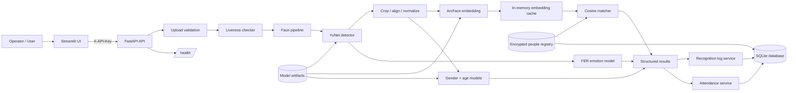

# FaceSense AI

FaceSense AI is an end-to-end face-analysis platform for controlled,
consent-based applications. It combines face detection, face recognition,
gender classification, approximate age estimation, emotion classification,
liveness detection, attendance tracking, privacy controls, a FastAPI backend,
and a Streamlit dashboard.

> **Responsible-use notice:** FaceSense AI is a research and engineering
> project. It must not be used to make high-impact decisions about people,
> identify individuals without informed consent, or infer sensitive attributes
> without a documented legal and ethical basis.

## Overview

The system accepts images, short frame sequences, or video and produces
structured face-analysis results. Registered identities are represented by
encrypted face embeddings. Recognition events and attendance records are
stored in SQLite and exposed through authenticated API endpoints.

The project is designed for local or controlled deployments where operators can
manage consent, access keys, model artifacts, retention, and auditability.

## Features

- YuNet/OpenCV face detection with bounding boxes and landmarks.
- ArcFace/InsightFace embeddings with cosine-similarity matching.
- Encrypted embedding storage using a Fernet key from the environment.
- Gender classification and approximate age regression with age groups.
- Seven-class emotion classification:
  `angry`, `disgust`, `fear`, `happy`, `neutral`, `sad`, `surprise`.
- Liveness detection using eye-blink landmarks and texture analysis.
- Spoof blocking for registration and attendance.
- Daily attendance with duplicate suppression and Excel export.
- Recognition logs, date/person filters, statistics, and retention cleanup.
- API-key authentication on all FastAPI routes.
- Consent checkbox and consent timestamp at registration.
- Delete-my-data endpoint for registration, logs, and attendance.
- Streamlit pages for upload analysis, live camera, registration, logs,
  dashboard charts, and attendance.
- Batched embedding and attribute inference with in-memory embedding caching.
- TensorFlow Lite conversion utility and before/after benchmark script.
- Unit, integration, and end-to-end tests with an 80% coverage target.

## Architecture



## Repository structure

```text
FaceSenseAI/
├── app/
│   ├── api/              # FastAPI application and routes
│   ├── core/             # Detection, preprocessing, liveness, runtimes
│   ├── models/           # Gender, age, and emotion model interfaces
│   ├── services/         # Pipeline, registry, logs, attendance, matching
│   └── utils/            # Drawing and shared utilities
├── data/
│   ├── raw/              # Original datasets
│   ├── processed/        # Prepared datasets and labels
│   └── known_faces/      # Controlled registration assets
├── models/               # Trained and downloaded model artifacts
├── notebooks/            # Exploration and training notebooks
├── reports/              # Evaluation metrics and generated plots
├── scripts/              # Operational smoke checks
├── tests/
│   ├── unit/
│   ├── integration/
│   └── end_to_end/
├── ui/                   # Streamlit application
├── config.py
├── requirements.txt
├── Dockerfile.api
├── Dockerfile.ui
└── docker-compose.yml
```

## Setup

### Local Python environment

Python 3.11 is required by the pinned TensorFlow stack.

```bash
python3.11 -m venv .venv
source .venv/bin/activate
python -m pip install --upgrade pip
python -m pip install -r requirements.txt
```

Windows PowerShell:

```powershell
py -3.11 -m venv .venv
.\.venv\Scripts\Activate.ps1
python -m pip install --upgrade pip
python -m pip install -r requirements.txt
```

Place the required model artifacts in `models/` before starting the API:

- `models/face_detection_yunet_2023mar.onnx`
- `models/gender.h5`
- `models/age.h5`

Download the YuNet detector artifact with:

```bash
curl -L \
  https://raw.githubusercontent.com/opencv/opencv_zoo/main/models/face_detection_yunet/face_detection_yunet_2023mar.onnx \
  -o models/face_detection_yunet_2023mar.onnx
```

The gender and age checkpoints are produced by the training commands below;
the API cannot perform full analysis until all three files exist.

### Environment variables

Copy the example file and set real secrets:

```bash
cp .env.example .env
```

Required:

- `FACESENSE_API_KEY`: shared API authentication key.
- `FACESENSE_ENCRYPTION_KEY`: stable Fernet key for stored embeddings.

Optional:

- `FACESENSE_API_URL`: backend URL used by Streamlit.
- `LOG_RETENTION_DAYS`: recognition-log retention period; read at process
  startup, default `90`.
- `API_PORT`: host API port, default `8000`.
- `UI_PORT`: host UI port, default `8501`.

Generate a Fernet key with:

```bash
python -c "from cryptography.fernet import Fernet; print(Fernet.generate_key().decode())"
```

For a local shell, export both required values before starting the API:

```bash
export FACESENSE_API_KEY="$(python -c 'import secrets; print(secrets.token_urlsafe(32))')"
export FACESENSE_ENCRYPTION_KEY="$(python -c 'from cryptography.fernet import Fernet; print(Fernet.generate_key().decode())')"
```

Alternatively, put the same values in `.env`; the local Uvicorn command does
not automatically load `.env` into the process.

Never commit `.env` or encryption keys. Changing the encryption key makes
existing encrypted embeddings unreadable.

### Run locally

```bash
python -m uvicorn app.api.main:app --host 0.0.0.0 --port 8000
```

Run the Streamlit UI in a **second terminal** after the API is running:

```bash
source .venv/bin/activate
export FACESENSE_API_URL=http://localhost:8000
export FACESENSE_API_KEY="the-same-value-used-for-the-api"
python -m streamlit run ui/app.py
```

The API health endpoint confirms that the process is reachable. A successful
`/analyze` request additionally requires the detector and trained gender/age
model files.

### Run with Docker Compose

```bash
cp .env.example .env
# Set FACESENSE_API_KEY and FACESENSE_ENCRYPTION_KEY in .env.
mkdir -p models
# Download face_detection_yunet_2023mar.onnx and create gender.h5 and age.h5
# as described in the model setup section above.
docker compose build api ui
docker compose create api
API_CONTAINER="$(docker compose ps -aq api)"
docker cp models/. "$API_CONTAINER:/app/models/"
docker compose start api
docker compose up -d ui
docker compose ps
```

The Compose stack exposes the API at `http://localhost:8000` and the UI at
`http://localhost:8501`. Named volumes `facesense_data` and
`facesense_models` persist the database/data and model artifacts. The
`docker cp` step is required on first setup because the named model volume
overlays the image's `/app/models` directory. Run it again after replacing
model artifacts.

Validate the complete running stack:

```bash
python -m pip install requests
python scripts/check_stack.py
```

## Data preparation and training

Prepare UTKFace-style files named `age_gender_race_date.jpg`:

```bash
python data/prepare_dataset.py
```

Train the gender model:

```bash
python train_gender.py
```

Train the age model:

```bash
python train_age.py
```

Convert the Keras models to TensorFlow Lite:

```bash
python convert_models.py \
  --gender-model models/gender.h5 \
  --age-model models/age.h5 \
  --output-dir models/tflite
```

Benchmark baseline versus batched inference and embedding caching:

```bash
python benchmark_pipeline.py data/benchmark --repetitions 3
```

## API reference

All routes require:

```http
X-API-Key: <FACESENSE_API_KEY>
```

### `GET /health`

Returns service status:

```json
{"status": "ok", "models_loaded": true}
```

### `POST /analyze`

Multipart upload field: `image`.

Accepted formats: JPEG, PNG, WebP. Maximum size: 10 MB.

Returns `faces`, where each result includes:

```json
{
  "box": [10, 20, 80, 80],
  "name": "Unknown",
  "person_id": null,
  "match_score": 0.42,
  "gender": "female",
  "gender_confidence": 0.81,
  "age": 31.4,
  "age_group": "young adult",
  "emotion": "happy",
  "emotion_confidence": 0.74
}
```

### `POST /register`

Multipart fields:

- `name`
- `person_id`
- `consent=true`
- `photos`: 3–5 JPEG, PNG, or WebP images

Registration requires consent and a live sequence. Embeddings are encrypted
before persistence.

### `GET /people`

Lists registered person IDs and names. Raw embeddings are not returned by the
API.

### `DELETE /people/{person_id}`

Deletes only the registered-person record.

### `DELETE /people/{person_id}/data`

Deletes the person’s registration, encrypted embedding, recognition logs, and
attendance records. Returns deletion counts.

### `POST /attendance`

Multipart field: `frames`, containing 2–10 short-sequence frames. Liveness is
required. Successful recognized people are marked present once per day.

### `GET /attendance`

Optional query parameter: `attendance_date=YYYY-MM-DD`.

### `GET /attendance/export`

Optional query parameter: `attendance_date=YYYY-MM-DD`. Returns an Excel
workbook with `person_id`, `date`, `time`, and `source` columns.

### `GET /logs`

Optional query parameters:

- `date_from=YYYY-MM-DD`
- `date_to=YYYY-MM-DD`
- `person_id`

### `GET /stats`

Accepts the same filters as `/logs` and returns totals grouped by gender,
age group, and day.

## Evaluation results

Run the evaluator after preparing the test split and trained models:

```bash
python evaluate.py
```

This writes `reports/metrics.json`,
`reports/gender_confusion_matrix.png`, and
`reports/age_error_by_bucket.png`.

The expected `metrics.json` schema contains the following values:

| Model / metric | Value |
|---|---:|
| Evaluation samples | Not generated in this repository |
| Gender accuracy | Not generated in this repository |
| Gender precision | Not generated in this repository |
| Gender recall | Not generated in this repository |
| Gender F1 | Not generated in this repository |
| Age MAE | Not generated in this repository |

No `reports/metrics.json` artifact is currently checked in, so numerical
accuracy claims would be unverified. After evaluation, replace the table
values from the generated JSON:

```json
{
  "samples": 0,
  "gender": {
    "accuracy": 0.0,
    "precision": 0.0,
    "recall": 0.0,
    "f1": 0.0
  },
  "age": {
    "mae": 0.0
  }
}
```

The reported age metric is mean absolute error in years. Gender metrics are
dataset metrics, not guarantees about individual predictions or demographic
groups outside the evaluation distribution.

## Limitations

### Lighting and image quality

Low light, glare, shadows, motion blur, occlusion, extreme pose, small faces,
and low-resolution images can reduce detection and recognition quality.
Liveness texture scores are also sensitive to camera quality and image
compression.

### Demographic bias

Training data composition affects performance across skin tones, ages,
genders, camera devices, hairstyles, facial coverings, and other groups.
Dataset-level averages can hide subgroup disparities. Measure performance
separately across relevant groups before deployment, and provide a human
review path.

### Age error

Age is an approximate regression estimate, not a verified age. Errors can be
large for children, older adults, unusual lighting, makeup, occlusion, and
domain shifts. Do not use the estimate for legal age verification or
eligibility decisions.

### Recognition and liveness

Recognition thresholds trade false matches against missed matches. Liveness
checks are safeguards, not proof of human presence, and can fail for unusual
capture conditions or new spoofing methods.

### Operational dependencies

Model files are not included in the repository. GPU acceleration, mobile
deployment, multi-camera scaling, key rotation, and distributed persistence
require additional deployment work.

## Ethical and privacy use

- Obtain informed, specific, revocable consent before registration.
- Explain what is collected, why it is collected, how long it is retained, and
  who can access it.
- Restrict API keys and encryption keys; use secret management in production.
- Do not use the system for covert surveillance or identification in public
  spaces.
- Do not make employment, education, housing, healthcare, policing, credit, or
  other high-impact decisions from these predictions.
- Treat gender and emotion outputs as uncertain model classifications, not
  facts about identity or inner state.
- Keep retention periods short and use the delete-my-data endpoint when
  appropriate.
- Log access and conduct security and subgroup-bias reviews before deployment.
- Provide human oversight, an appeal mechanism, and a way to disable automated
  decisions.

## Testing

Tests are organized by level:

- `tests/unit/`: isolated components and services.
- `tests/integration/`: API, pipeline, data, video, and benchmark workflows.
- `tests/end_to_end/`: UI and complete privacy flows.

Run the suite with the configured 80% coverage target:

```bash
python -m pytest --cov --cov-report=term-missing
```

## Project report outline

The following structure can be used for a formal project report.

### Abstract

Summarize the problem, the FaceSense AI system, the methods used for
detection/recognition and attribute estimation, the privacy and liveness
controls, the evaluation protocol, and the principal measured results.

### Objectives

1. Build an end-to-end face-analysis pipeline.
2. Recognize consented registered identities using face embeddings.
3. Estimate gender, approximate age, and facial emotion with explicit
   uncertainty.
4. Reject common photo and screen spoof attempts.
5. Provide attendance, logging, API, and dashboard workflows.
6. Protect biometric data through encryption, authentication, retention, and
   deletion controls.
7. Benchmark batched inference and embedding caching against the baseline.

### Methodology

Describe dataset preparation, train/validation/test splitting, preprocessing,
face detection, alignment, embedding extraction, cosine matching, attribute
models, FER emotion inference, liveness checks, database schema, API design,
Streamlit integration, optimization strategy, and test methodology.

### Results

Report:

- Dataset size and split composition.
- Gender accuracy, precision, recall, and F1 from `reports/metrics.json`.
- Age MAE and error by age bucket.
- Confusion matrix interpretation.
- Liveness live/spoof test outcomes.
- Attendance duplicate-suppression behavior.
- API and UI test results.
- Baseline versus optimized milliseconds per image and per face.
- Coverage percentage and skipped tests with reasons.

### Conclusion

Summarize whether the system met its engineering objectives, identify
deployment risks and validity boundaries, and state which safeguards are
required before any real-world use. Conclusions must distinguish measured
dataset performance from unverified assumptions and must not overstate model
accuracy or fairness.

## Future improvements

- Add subgroup and intersectional fairness evaluation with confidence
  intervals.
- Improve calibration and expose prediction uncertainty consistently.
- Replace heuristic liveness with a trained, continuously evaluated
  presentation-attack detector.
- Add model/version provenance and signed artifact verification.
- Support key rotation and envelope encryption without losing old data.
- Move production persistence to a managed database with migrations and
  audited access.
- Add rate limiting, role-based access control, structured audit logs, and
  secret-manager integration.
- Add GPU/TFLite deployment profiles and measure latency on target hardware.
- Improve tracking and temporal smoothing for crowded video.
- Add multilingual accessibility support and operator review workflows.
